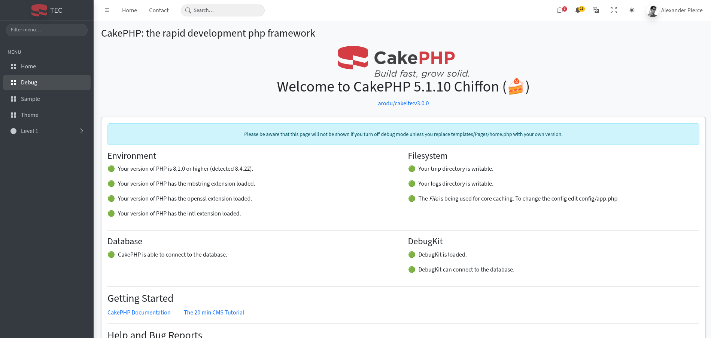
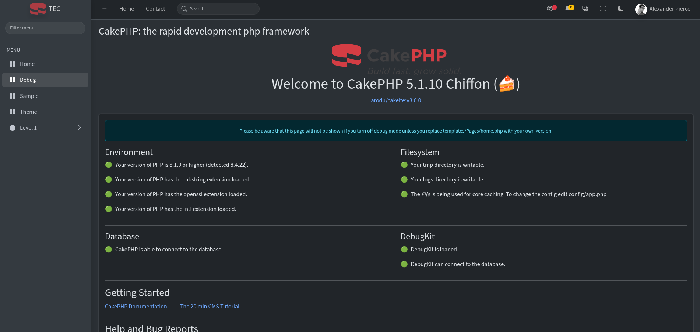

# Pages

CakeLTE ships two sample pages you can use to test the layout.

## Debug page

The debug page shows application and plugin information. Link to it from any
template:

```php
echo $this->Html->link(__('CakeLTE debug page'), '/cakelte/debug');

// {your-url}/cakelte/debug
```





## Sample page

The sample page (`/cakelte/sample`) demonstrates the menu helpers and various
Bootstrap navigation components (navbar, nav, nav-pills, nav-tabs).

Both routes are registered by the plugin, but the controller only serves them
when `Configure::read('debug')` is true. In production they return 404.

---
[Back to index](index.md)
